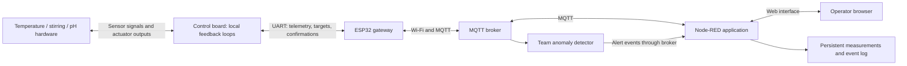

**Connectivity and user interface: proposed implementation plan for CSEEE-21**

Prepared from the supplied project materials and eight-page team presentation, 2 November 2026. This is a design proposal; none of the hardware connections, network services or performance targets below have been tested in this review.

**Recommended scope**

Build one shared interface that lets an operator see temperature, stirring speed and pH, change their target values, recognise faults or lost connectivity, and export trustworthy experimental records. Keep the physical feedback control on the control microcontroller. Use a second ESP32 as a network gateway, communicating with the controller over UART and with a dashboard application over Wi-Fi/MQTT.

Use Node-RED with FlowFuse Dashboard for the first implementation. It is suggested in the teaching material, and provides a practical route to charts, forms and MQTT integration. Your engineering contribution is the interface contract, command validation, confirmation, logging, failure behaviour and testing. A custom Python or JavaScript application is a reasonable alternative if you already know that stack well; avoid learning an extensive new framework just for this project.

**What the brief actually requires**

The design specification, PDF page 4, requires the following:

| Parameter | Allowed target range | Required control performance |
|---|---|---|
| Temperature | 25–35 °C | Within ±0.5 °C of target |
| Stirring | 500–1500 RPM | Within ±20 RPM of target |
| pH | 3–7 | No numerical tolerance given in the supplied specification |

All subsystems must log data and provide monitoring and adjustable setpoints. The notes mention pH 5 as a default. Treat that as the provided testbed default, not as a scientifically established optimum for every biological process. Any biological operating-point justification belongs to the team's research.

The interface must accept valid targets throughout these ranges. Measured values must still be displayed and recorded outside them: the inlet water is explicitly expected to start at 10–20 °C. Do not clamp measured temperature to 25 °C or discard excursions as invalid simply because they are outside the target range. Sensor-validity limits and allowable target limits are different.

The specification, pages 14–18, emphasises measured results, block diagrams, flowcharts and screen wireframes. A proposal that explains how you will verify the system is stronger than a list of software features.

**Resolve these team inconsistencies first**

1. Agree the exact control board. Team slide 3 says Arduino Nano; slides 4 and 5 say Uno; slide 6 says Nano. The equipment list and Connectivity lecture identify Arduino Nano ESP32. These names are not interchangeable. Use exact names consistently and confirm the actual boards with your teammates.
2. Agree whether one control board runs all three loops. The overall diagram suggests this; use it as the working assumption. If there are three separate controllers, UART cannot simply be wired as one shared bus: you need separate interfaces or a deliberately designed addressed network.
3. Confirm the current stirrer sensor. The recent equipment list says Hall sensor, 70 pulses per revolution and 10:1 gearing; the older specification and team slide 6 describe an optical sensor. Establish which shaft the pulse count refers to, and report vessel stirrer RPM consistently.
4. Agree pins, logic levels, ground and power wiring with the EEE members before connecting boards. The Nano ESP32 uses 3.3 V GPIO; an older 5 V Uno needs appropriate signal-level interfacing to an ESP32. Do not confuse the actuator supply voltage with GPIO voltage or assume a generic Nano pinout. See the [official Nano ESP32 datasheet](https://docs-content.arduino.cc/resources/datasheets/ABX00083-datasheet.pdf).
5. Replace the vague 'Cloud Server / User Interface' box with the actual functions: MQTT broker, dashboard application and persistent log. They are distinct, even if some run on the same computer.

The timetable supplied is for 2026–27, whereas several lectures contain 2024/2025 dates. Its week 5 is 2–8 November and week 10 is 14–20 December. Use the current Moodle submission instructions for the exact deadline rather than the old introduction's '29 Oct' text.

**Proposed architecture and ownership**



The controls team owns calibration, sensor acquisition, feedback algorithms, actuator driving and local fault handling. You own gateway communication, message definitions, dashboard behaviour and logging. Agree the controller's UART parser and command-confirmation implementation jointly. The analysis teammate owns the detector and its evaluation; you supply clean time series and display its output.

The operator changes targets. The local controller determines the heater, motor and pump outputs. Do not make the browser responsible for the control loop or expose unrestricted pump/heater commands as the normal interface.

**Concrete technology choices**

| Connection/function | Initial choice | Reason and constraint |
|---|---|---|
| Controller ↔ gateway | Hardware UART, initially 115200 baud, 8N1 | Two-way communication between two nearby boards; easy to inspect and sufficient for the data volume. Cross TX/RX, share ground, verify voltage compatibility and available pins. |
| Gateway ↔ broker | Wi-Fi and MQTT; PicoMQTT client | Matches the teaching examples and lets dashboard and analysis clients consume the same telemetry. |
| Dashboard | Node-RED + `@flowfuse/node-red-dashboard` | Charts, forms and MQTT support without a large application framework. |
| Durable records | Append-only CSV measurement file and separate command/event file per run | Easy to inspect and use in the final report. SQLite is an optional upgrade for convenient historical queries. |
| First development data | Your own deterministic fake controller, then optional course simulator stream | Lets you build immediately while hardware is being assembled. Label simulated data clearly. |

I²C is also viable, particularly if the team has already implemented it successfully. SPI adds wiring that is unlikely to be justified by this modest data rate. UART is a recommendation, not a course requirement.

For lab development, try the course broker `engf0001.cs.ucl.ac.uk` from both the ESP32 and your laptop. Connectivity.pdf page 19 says it is only visible inside UCL; its present availability, port, authentication and network access still need checking. Run Node-RED on the laptop and open its dashboard locally. Both the laptop application and ESP32 make connections to the broker, so the ESP32 does not need an incoming connection to a web server on the laptop.

Connectivity.pdf page 18 explicitly says not to plan on running a server on eduroam. A dashboard accessible from any browser anywhere would require suitable hosting and access control; that is additional scope. A remote operator laptop receiving reactor data through the broker is already a useful first demonstration.

Keep broker and Wi-Fi settings configurable. A permitted private Wi-Fi network with a laptop broker is a possible fallback, but test device-to-device access first. Open public brokers are useful for synthetic telemetry experiments; a unique topic name avoids accidental collisions but does not authenticate commands. Before controlling the physical rig, establish who can publish commands and use an authenticated broker or controlled demonstration network. Keep credentials out of slides and shared code.

**Define the data contract before integrating**

Write down field names, units, message types, maximum size, update rate and error handling in one shared document. For two ESP32-class boards, bounded newline-delimited JSON is a readable starting format for UART. A small fixed record format may be preferable if the team actually has an Uno with limited memory. Keep debugging text off the protocol UART, reject malformed/oversized records and recover at the next frame boundary. Add a checksum if serial corruption tests justify it.

Proposed telemetry fields:

- Schema version, device ID, run ID, controller boot ID and increasing sample sequence.
- Controller sample uptime; server receipt time in UTC. Add source UTC only if synchronisation is available and verified.
- Measured temperature in °C, stirring RPM and pH; sensor-validity flags.
- Actual accepted targets, with their revision or last command ID.
- Heater/motor output and acid/base activity, when supplied by the controller.
- Controller mode and fault flags; gateway connection/serial freshness status.

Use controller sample sequence and time to detect a frozen controller even if the gateway remains online. Never overwrite old sample times or repeatedly republish an old measurement as a new reading. Represent missing values explicitly, rather than converting them to zero.

Suggested topic root: `cseee21/<device-id>/...`.

| Topic suffix | Publisher → consumer | Purpose |
|---|---|---|
| `telemetry` | Gateway → dashboard, logger, detector | Measurements, accepted targets, source freshness |
| `command` | Dashboard → gateway → controller | Request an absolute target change |
| `ack` | Controller via gateway → dashboard | Applied/rejected result with matching command ID |
| `status` | Gateway → dashboard | Connectivity and controller-link status |
| `alerts` | Detector → dashboard/logger | Alert onset/clear, affected parameter, score and explanation |

Example application messages, with illustrative values:

```json
{"schema":1,"type":"setpoint","command_id":"ui-run17-0042","target_boot_id":"boot8","parameter":"temperature_C","value":30.0}
```

```json
{"schema":1,"type":"ack","command_id":"ui-run17-0042","boot_id":"boot8","status":"applied","parameter":"temperature_C","value":30.0}
```

The gateway receiving a command is not confirmation that the controller applied it. The dashboard should show pending until the controller returns a matching result, then display the confirmed target. The fluid reaching that target is a later physical event, distinct from command acceptance.

Use non-retained commands and avoid broker sessions that queue obsolete commands while the rig is disconnected. Include command IDs, current controller boot ID and a defined freshness rule. For example, add a recent controller sample sequence and reject a request more than a small agreed number of samples old. A UTC expiry is another option only when clocks are synchronised. Cancel retries after disconnect; obtain fresh state before allowing a new request.

Use absolute setpoints rather than incremental commands such as 'increase by 1'. Deduplicate repeated command IDs on the controller and resend the recorded result. Permit one outstanding command per parameter initially. Apply both dashboard and controller-side numeric/range validation. Unknown parameters, wrong devices, malformed values and non-finite numbers must be rejected.

MQTT delivery acknowledgements do not establish physical controller acceptance. QoS 1 can duplicate messages, so application confirmation and deduplication still matter. Use QoS 0 for periodic telemetry if gaps are acceptable; consider QoS 1 for commands/confirmations after confirming the installed client version supports it. The current PicoMQTT client documentation lists QoS 0/1; its embedded broker has different limitations. Pin the tested versions. [PicoMQTT documentation](https://github.com/mlesniew/PicoMQTT), [MQTT 3.1.1 specification](https://docs.oasis-open.org/mqtt/mqtt/v3.1.1/os/mqtt-v3.1.1-os.html).

**Dashboard behaviour**

Use the accompanying `Connectivity_UI_Wireframe.svg` as a screen proposal. All values in it are illustrative.

- Top strip: device/run identity, live/simulated mode, connection health, last new controller sample age and logging health.
- Three parameter panels: large measured value with units; confirmed target; editable requested target; explicit Apply button; pending/applied/rejected feedback.
- Three time plots: measured value and accepted target on the same time axis. Temperature and RPM can show ±0.5 °C and ±20 RPM bands during appropriate steady-state assessment. Agree a pH criterion with the pH team instead of inventing one.
- Alerts/events: distinguish sensor faults, communication loss, out-of-tolerance readings and statistical anomaly warnings. Include text labels, not colour alone.
- Run controls: name/start a logging run and export the recorded CSV. Show whether recording is actually working.

Setpoint inputs must not automatically send a command on every keystroke or slider movement. On a lost connection, preserve the last value with an unmistakable stale label, disable new commands, and mark the gap in the chart. A fresh browser connection to Node-RED does not prove that the controller data is fresh.

The local controller should continue its last accepted targets during a network-only outage while sensors remain healthy, with a separate locally enforced fault policy. Agree what sensor failure, controller restart or loss of stirring means for heating and dosing with the subsystem owners. A web button cannot provide a reliable emergency stop during network failure.

**Logging and the data-analysis handoff**

Persist received samples and events even when no browser is open. Store measured values, accepted targets, output levels, validity, identifiers and times. Keep setpoint-change and acknowledgement events. Record gaps, duplicates and reconnects. Chart history and an MQTT broker are not, by themselves, a durable experiment log.

For the first version, be explicit that a network outage creates missing samples. Do not claim uninterrupted recording. Buffer-and-replay on the gateway is a possible later extension; replayed data must preserve acquisition times and be labelled as historical.

Give the analysis teammate representative normal data and deliberate setpoint transitions, plus the agreed schema. Subscribe to their alert output instead of reimplementing median/MAD detection inside the interface. The simulator lecture has a one-second summary stream with `mean`, `min`, `max` and setpoints; adapt it explicitly if used. Its sample RPM target of 300 is not the physical rig's required 500–1500 RPM range. Fault labels in labelled simulator data are evaluation ground truth, not detector predictions or a feature available on the real rig.

**Implementation milestones**

| Period | Your concrete output | Evidence of completion |
|---|---|---|
| Now / week 5 proposal | Board/topology decision; architecture diagram; screen wireframe; interface contract v1; test targets; named responsibilities | Team can explain the complete path of one reading and one command |
| Week 5 / reading week | Fake controller → broker → dashboard → CSV; reverse command with simulated acknowledgement | Three changing readings; a confirmed target change; file reopened successfully |
| Week 6 | Real gateway Wi-Fi/MQTT and UART round trip; integrate one real parameter first | Controller-confirmed target and matching measurement visible in dashboard |
| Week 7 | All three real subsystems integrated; persistent logging; analysis handoff | One timestamped run covering temperature, RPM and pH |
| Week 8 | Disconnect/reconnect, malformed command, duplicate and sensor-fault tests; integrate alerts | Saved test results and visible failure states |
| Week 9 | Full-system performance run, bug fixes and presentation rehearsal | Exported graphs, measured communication results and reproducible startup checklist |
| Week 10 | Demonstration and report evidence | Repeatable live demo with logs and an honestly labelled fallback recording |

Do not wait for the finished hardware to start. Your first useful deliverable is a working fake reading and a round-trip target change. Keep mobile layouts, elaborate styling, multi-user accounts, notifications and cloud deployment behind the core requirements.

**Proposed acceptance tests**

These timings and sample rates are team design targets, not requirements stated by the course. Agree them, measure them and revise honestly if necessary. Telemetry reporting at 1 Hz does not specify the sensor or control-loop rate; the controls team may need much faster acquisition and local logging for RPM tuning.

| Test | Suggested target / expected result | Evidence |
|---|---|---|
| Normal telemetry | One newly acquired report per second; display pipeline normally within 2 s | Known injected sequence and measured timing. For source-to-screen delay, use synchronised clocks or a traceable test event; receipt time alone is insufficient. |
| Target changes | 20 valid commands each reach matching controller confirmation; target 95th-percentile confirmation time ≤2 s on the chosen network | Command/ack timestamps on the same application clock and active-target telemetry |
| Boundary checks | Accept 25/35 °C, 500/1500 RPM, pH 3/7; reject out-of-range, malformed and non-finite commands | Rejection log and unchanged controller target |
| Stale/frozen data | Mark stale and disable commands within 5 s without a new controller sample | Disconnect UART as well as Wi-Fi; keep gateway alive in one test |
| Recovery | Resume live monitoring automatically; no replay of old commands; pending changes resolved against actual state | Wi-Fi/broker restart and controller reboot traces |
| Duplicate delivery | Repeated command ID does not cause an additional control change | Send duplicate requests, check stored result and target revision |
| Logging | Every valid received sample in a 30-minute test is persisted; source-sequence gaps counted explicitly | Reopen CSV after closing browser/application; distinguish network loss from logger loss |
| UI usability | A teammate can identify all three values, change one target and recognise stale data without coaching | Short observed task and fixes |
| Whole-system performance | Show measured temperature/RPM against brief tolerances; agree pH criterion | Steady-state windows, setpoint transitions, calibration references and plots |

One-second graphs alone cannot prove subsecond control performance. Use suitable controller-side measurements for that claim. Report command latency separately from physical settling time, and separate normal warm-up/transients from steady-state tolerance assessment.

**How to present it**

Use `Connectivity_and_UI_Slide_Content.md` for paste-ready text and speaker notes. Prefer two core slides: architecture/communication and dashboard/verification. If there is room for only the existing slide 7, combine the architecture and a reduced wireframe with three measurable commitments. Put protocol details and the test matrix in backup material.

**Source map**

- `3_Bioreactor Design Specification v4_notes.pdf`: page 4 for ranges and logging/UI; pages 12–13 for two-way connectivity; pages 14–18 for results and modelling deliverables.
- `Connectivity.pdf`: pages 5–14 for wired protocols; pages 15–19 for Wi-Fi/MQTT, eduroam and broker constraints; pages 19–20 for dashboard options.
- `Engineering Challenges Presentation.pdf`: pages 3–6 for current architecture; page 7 is the missing section; page 8 is the analysis interface to support.
- `List of bioreactor testbed elements.txt`: current board and stirrer information, listed as modified 26 October 2026.
- `eduroam.ino`: initial Wi-Fi connection example. Its main loop is empty; reconnect handling, MQTT and application protocol remain to be implemented.
- `Anomaly_detection_slides.pdf`: pages 16–19 for median/MAD and hysteresis; pages 31–41 for simulator, workflow and message fields.
- `2_Design Approaches and Tools_v2_notes.pdf`: requirements, architecture, flowcharts and wireframes; `Design Example.pdf`: calibration and evidence-led testing.
- `Introduction_to_Feedback_Control_Systems.pptx` and `Introduction_to_Transistors.pdf`: local control and hardware context; these do not specify the network application.
- `Challenge 2 timetable 26-27.pdf`, housekeeping and introduction presentations: delivery phases, with the date inconsistency noted above.

The current [FlowFuse getting-started guide](https://dashboard.flowfuse.com/getting-started.html) identifies `@flowfuse/node-red-dashboard` as the modern dashboard package. [Node-RED's MQTT cookbook](https://cookbook.nodered.org/mqtt/connect-to-broker) documents broker connections. Protect the editor and dashboard appropriately if they are exposed beyond the local development machine; [Node-RED's security guide](https://nodered.org/docs/user-guide/runtime/securing-node-red) explains the separate controls. [Arduino's Nano ESP32 documentation](https://docs.arduino.cc/hardware/nano-esp32/) confirms that this board itself has Wi-Fi, so a two-board design should be justified by the course architecture and separation of control/network responsibilities, not by claiming the Nano ESP32 lacks networking.
